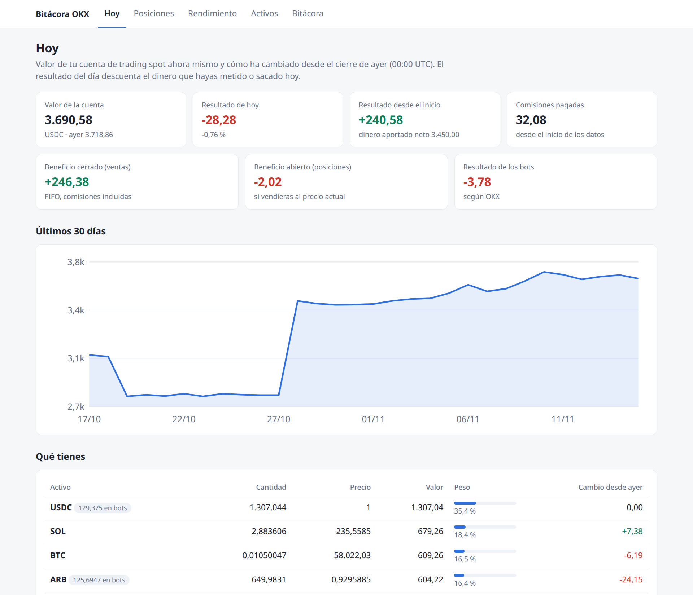
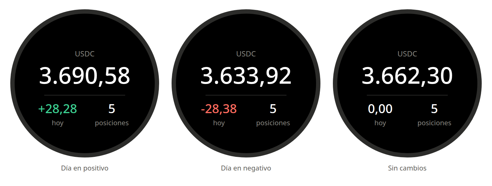
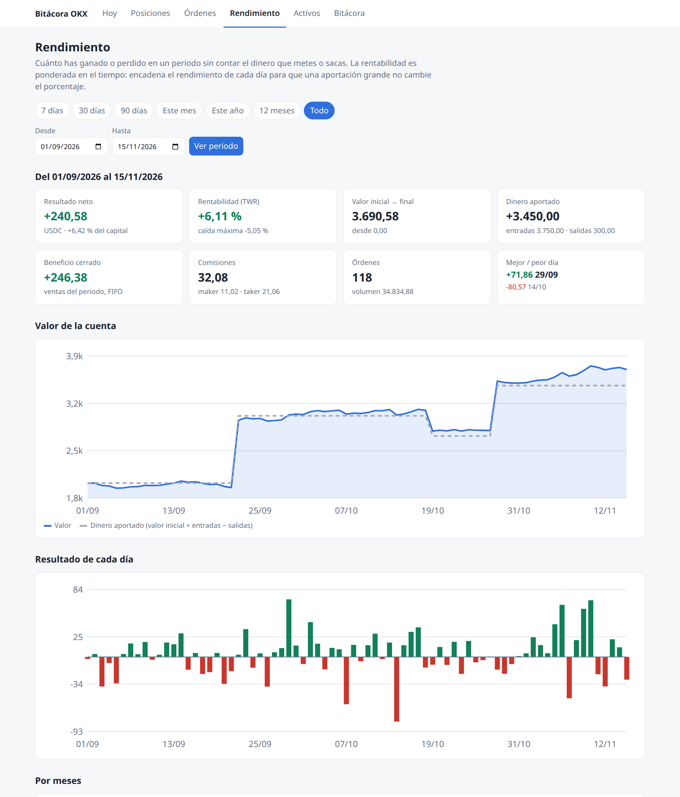
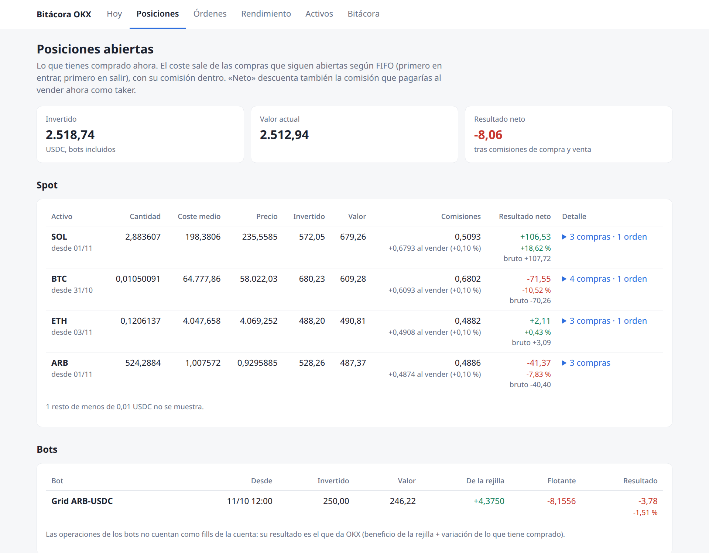
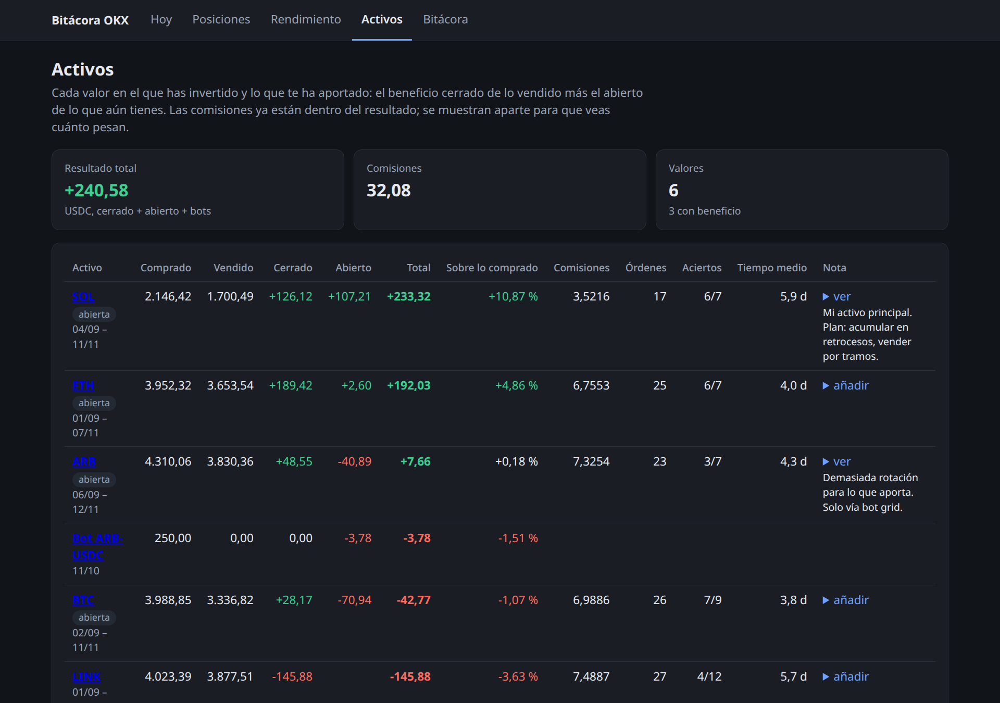
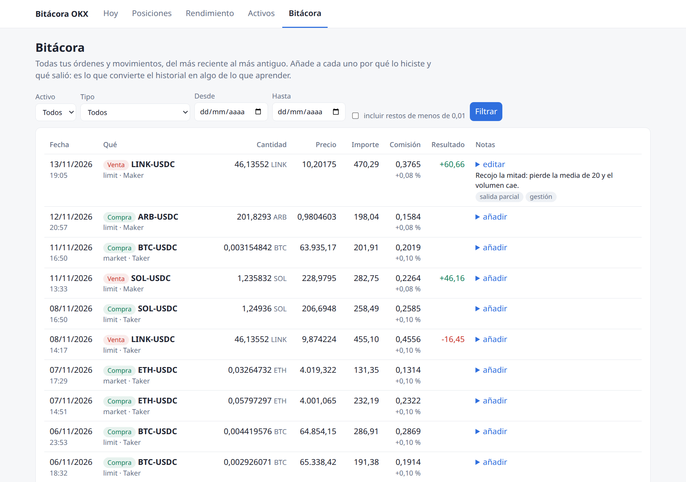
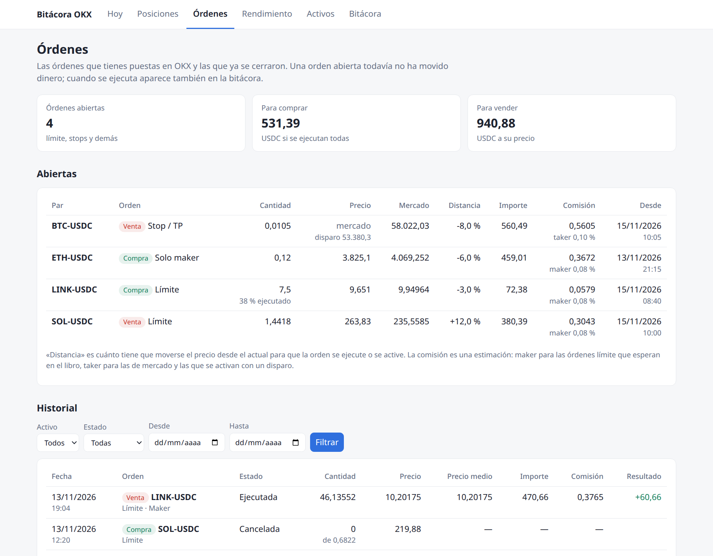
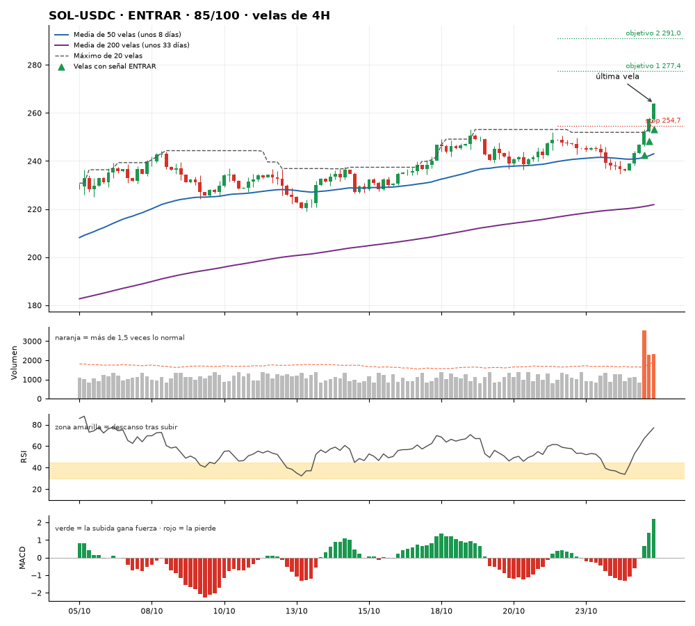
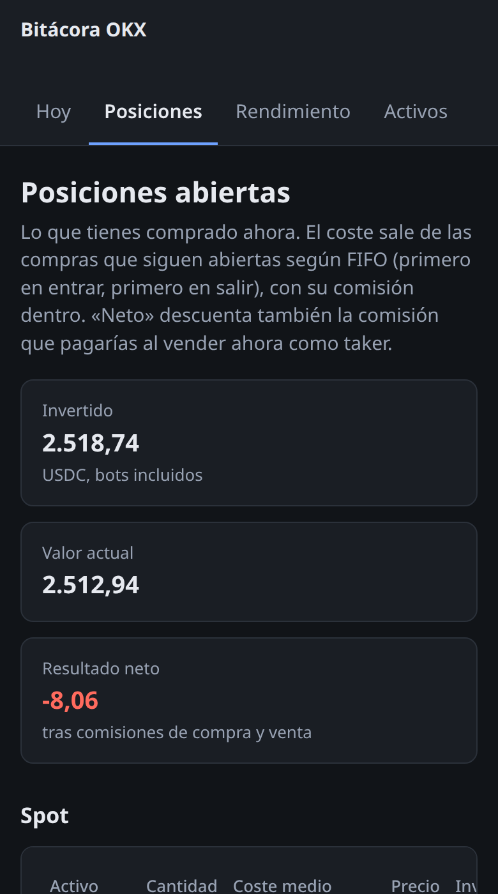
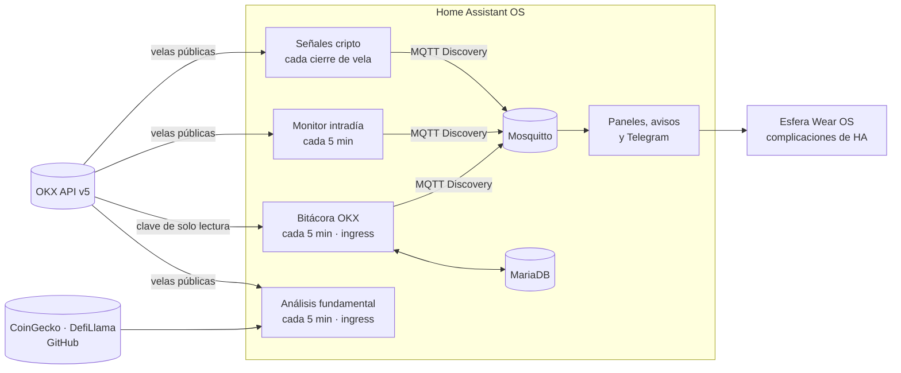

<div align="center">

# HA Trading Helper

**Cuatro apps de Home Assistant y una esfera de reloj para seguir el mercado cripto de OKX,
analizar sus fundamentales y llevar un diario de tus inversiones, explicadas en lenguaje llano.**

[](https://github.com/jmanera/ha-trading-helper/actions/workflows/ci.yml)


[](LICENSE)



<sub>Bitácora OKX con una cuenta de demostración (datos inventados).</sub>

</div>

> [!WARNING]
> No es asesoramiento financiero. Las criptomonedas pueden perder gran parte de su valor. La
> estrategia de señales **no ha demostrado ventaja** fuera de muestra
> ([validación](docs/validation.md)): las señales son informativas.

## Las apps

<table>
<tr>
<td width="33%" valign="top">

### 📈 Señales cripto

Puntúa de 0 a 100 los pares spot más líquidos de OKX al cerrar cada vela, con seis
evidencias técnicas, y **explica cada señal** punto a punto. Valida la estrategia con un
walk-forward sin sesgo de supervivencia. Opcional: comprar y vender desde Telegram con
confirmación.

</td>
<td width="33%" valign="top">

### ⏱️ Monitor intradía

Vigila velas de 5 y 15 minutos y avisa de volumen anómalo, movimientos bruscos, rupturas de
24 h y cambios de mercado. Al mismo tiempo **mide en papel** dos reglas intradía fijas
frente a un control al azar, para saber si tienen ventaja real.

</td>
<td width="33%" valign="top">

### 📒 Bitácora OKX

Panel de **tu cuenta** en la barra lateral de Home Assistant, de solo lectura: posiciones
con coste FIFO y comisiones maker/taker, órdenes abiertas e historial, rendimiento neto de cualquier periodo, resultado
por activo y notas propias en cada operación. Guarda el histórico en MariaDB.

</td>
</tr>
</table>

### 🔎 Análisis fundamental

Todos los pares cripto/USDC de OKX con su cambio y volumen de las últimas 4 horas y, en cada
uno, un **análisis fundamental**: puntuación de 0 a 100, tokenomics, adopción, finanzas,
desarrollo, riesgo de dilución y de liquidez y perspectiva alcista, neutral o bajista, cada
métrica explicada. Con datos públicos de OKX, CoinGecko, DefiLlama y GitHub
([cómo puntúa](crypto_fundamentals/DOCS.md)).

### ⌚ Y en la muñeca

La esfera **Bitácora OKX** para Wear OS (probada en un Galaxy Watch 5) muestra el valor de la
cuenta, el resultado de hoy en verde, rojo o blanco, y las posiciones abiertas, con la hora
arriba y la fecha abajo. Toma los datos
de Home Assistant y no necesita ninguna app propia en el móvil. [Cómo instalarla](wear/README.md).

<p align="center"></p>

## Capturas

| Rendimiento por periodos | Posiciones con comisiones |
|---|---|
| [](docs/img/journal-rendimiento.png) | [](docs/img/journal-posiciones.png) |
| **Resultado por activo** (modo oscuro) | **Bitácora con notas** |
| [](docs/img/journal-oscuro.png) | [](docs/img/journal-bitacora.png) |

**Órdenes abiertas e historial**: a qué distancia del precio está cada orden, cuánto moverían
y su comisión estimada; debajo, las ejecutadas y las canceladas.

[](docs/img/journal-ordenes.png)

<table>
<tr>
<td width="62%" valign="top">

**Gráfico de cada señal**, publicado como entidad `image` en Home Assistant: medias de 50 y
200 velas, máximo de 20 velas, stop y objetivos, volumen, RSI y MACD, con leyendas pensadas
para quien no es experto.



</td>
<td width="38%" valign="top">

**En el móvil**, la bitácora se adapta y respeta el tema claro u oscuro.



</td>
</tr>
</table>

Cada señal también se explica en texto:

```text
SOL-USDC · ENTRAR · puntuación 85/100 · vela 2026-11-10 16:00 UTC
Motivos:
  +25  Tendencia: alcista, cierre 188,4 > EMA50 181,2 > EMA200 160,7
  +20  MACD: histograma pasa de -0,31 a 0,12
  +15  RSI(14): sube de 38 a 47 tras zona de retroceso
  + 0  Ruptura: cierre no supera el máximo de 20 velas (192,0)
  +10  Volumen: 1,8x la media de 20 velas (≥ 1,5x)
  +15  Fuerza relativa: +9,4 % vs BTC en 30 velas
Niveles: entrada 188,4 · stop 179,9 (2,0×ATR) · objetivos 201,1 / 213,9
```

## Cómo está hecho



- **Núcleo puro y testeado.** Indicadores, reglas y cálculos de la bitácora son funciones sin
  red ni reloj. El backtest y las señales en vivo ejecutan exactamente el mismo código.
- **Validación honesta.** Walk-forward con costes, universo reconstruido vela a vela para no
  quedarse solo con las monedas que sobrevivieron, y 26 variantes documentadas
  ([research](docs/research/trials.md)).
- **Contabilidad como la de Hacienda.** FIFO con las comisiones dentro del coste. La
  rentabilidad es ponderada en el tiempo (TWR) para que una aportación no parezca ganancia.
- **Seguro por defecto.** Las señales no necesitan claves; la bitácora solo lee; operar exige
  confirmación en Telegram, stop-loss en el exchange y validación positiva.
- **Decisiones documentadas** en [ADRs](docs/adr/).

## Inicio rápido

Necesitas [uv](https://docs.astral.sh/uv/) y, para el stack completo, Docker.

```bash
uv sync                                    # dependencias
uv run ha-trading-helper scan              # ranking con motivos, sin Home Assistant
uv run python docs/demo/demo_journal.py .data/demo.db --serve   # bitácora de demo en :8099
make up                                    # Mosquitto + Home Assistant + apps en Docker
```

Para instalarlas en tu Home Assistant como apps locales:

```bash
make app-bundle    # una carpeta por app en dist/
```

Copia esas carpetas a `/addons/` y búscalas en *Ajustes → Apps → Tienda de apps*. El paso a
paso, las opciones y las entidades de cada app están en el **[manual de uso](docs/manual.md)**.

La esfera del reloj se compila con el Android SDK y se instala por ADB Wi-Fi
([guía](wear/README.md)):

```bash
make wear-install   # compila wear/ e instala la esfera en el reloj conectado con adb
```

## Calidad

| Aspecto | Cómo |
|---|---|
| Tests | unitarios, de propiedades (Hypothesis) e integración con Mosquitto y MariaDB reales en Docker |
| Cobertura | > 90 % en total y 100 % en indicadores y estrategia |
| Tipos y estilo | `mypy --strict`, Ruff |
| Seguridad | Bandit, pip-audit y escaneo de secretos |
| CI | GitHub Actions: lo anterior, las imágenes de las cuatro apps para amd64 y arm64, y la esfera validada con el esquema oficial de Google y compilada |

```bash
make check    # lint + tipos + tests + auditoría
```

## Documentación

- [Manual de uso](docs/manual.md): instalación, opciones, entidades y uso de las apps.
- [Bitácora OKX](okx_journal/DOCS.md): requisitos, MariaDB y cómo calcula.
- [Análisis fundamental](crypto_fundamentals/DOCS.md): fuentes, claves gratuitas y cómo puntúa.
- [Apps de reloj](wear/README.md): la esfera, cómo instalarla y cómo añadir más apps de Wear OS.
- [Validación](docs/validation.md) e [investigación](docs/research/) de la estrategia.
- [Decisiones de diseño](docs/adr/).

## Contribuir

Es un proyecto personal que comparto como portfolio. Si encuentras un fallo o tienes una idea,
**abre un [issue](https://github.com/jmanera/ha-trading-helper/issues)**. No se aceptan pull
requests.

## Licencia

[MIT](LICENSE) © Juan Manera
