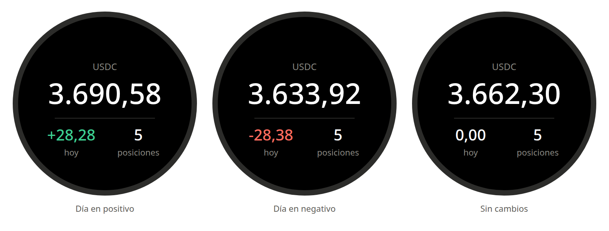

# Apps de reloj (Wear OS)

Apps para relojes Wear OS (Galaxy Watch 4 y posteriores, Pixel Watch…). Cada una es un
módulo de Gradle dentro de esta carpeta.

| Módulo | Qué es |
|---|---|
| [`okx-journal-face/`](okx-journal-face/) | Esfera **Bitácora OKX**: valor de la cuenta, resultado de hoy y posiciones abiertas |

<p align="center"></p>

## Esfera Bitácora OKX

Está hecha con [Watch Face Format](https://developer.android.com/training/wearables/wff)
(versión 2, Wear OS 4 o posterior): es un diseño en XML, sin código. Los datos llegan como
**complicaciones** de la app de Home Assistant, a partir de los sensores que publica la app
[Bitácora OKX](../okx_journal/DOCS.md):

| Hueco | Sensor | Cómo se ve |
|---|---|---|
| Arriba, grande | `sensor.okx_journal_valor` | blanco |
| Abajo, izquierda | `sensor.okx_journal_resultado_hoy` | verde si sube, rojo si baja, blanco si es 0 |
| Abajo, derecha | `sensor.okx_journal_posiciones` | blanco |

En el modo de pantalla siempre encendida los números se atenúan y la línea desaparece.

### 1. Compilar

Necesitas un JDK 17 o posterior y el Android SDK (el de Android Studio sirve).

```bash
export ANDROID_HOME=$HOME/Android/Sdk
make wear
```

Deja el APK en `wear/okx-journal-face/build/outputs/apk/release/`. La CI también lo compila
y lo publica como artefacto (`wear-apks`) en cada ejecución.

### 2. Instalar en el reloj (Galaxy Watch 5)

1. En el reloj: *Ajustes → Información del reloj → Software* y toca 5 veces *Versión de
   software*. Aparecen las *Opciones de desarrollador*.
2. En *Opciones de desarrollador*, activa **Depuración ADB** y **Depuración inalámbrica**. El
   reloj y el ordenador tienen que estar en la misma Wi-Fi.
3. En *Depuración inalámbrica → Vincular nuevo dispositivo* el reloj muestra una IP, un puerto
   y un código:

   ```bash
   adb pair <ip>:<puerto-de-vinculación>    # pide el código
   adb connect <ip>:<puerto>                # el que aparece en «Depuración inalámbrica»
   make wear-install
   ```
4. Mantén pulsada la esfera actual, desliza hasta el final, pulsa **Añadir esfera** y elige
   **Bitácora OKX**.

### 3. Conectar los datos

Necesitas la app **Home Assistant** en el reloj, con sesión iniciada (se vincula desde la app
del móvil). La esfera ya propone Home Assistant en sus tres huecos; falta elegir el sensor de
cada uno:

1. Mantén pulsada la esfera → **Personalizar** → toca cada hueco.
2. Elige **Home Assistant → Estado de entidad** y el sensor de la tabla de arriba.
3. Deja **sin unidad** cada complicación: la esfera ya pone «USDC», «hoy» y «posiciones».

Mientras un hueco no tenga sensor elegido, Home Assistant muestra «Estado de la entidad». Si
muestra `--`, no tiene ninguna complicación asignada.

Probada en un Galaxy Watch 5 (SM-R860) con Wear OS 6.

### Límites

- **Se actualiza cada 15 minutos.** Es el intervalo que la app de Home Assistant fija para sus
  complicaciones, y Wear OS lo respeta para ahorrar batería.
- El color del resultado se decide por el texto que manda Home Assistant: rojo si empieza por
  «-» o «−», blanco si es cero (`0`, `0,0`, `0,00`…), verde en cualquier otro caso.
- Si el selector se queda «pensando» al aplicar una esfera, mira el registro del reloj
  (`adb logcat | grep -E "IllegalArgument|WearServices"`): Wear OS rechaza la esfera ahí y el
  selector no muestra el error. `wear/tools/validate_wff.py` detecta el caso más común.
- Va firmado con la clave de depuración, que basta para instalarlo tú. Para publicarlo en
  Google Play haría falta tu propia clave y la revisión de Google.

### Cambiar el diseño

- Diseño: [`okx-journal-face/src/main/res/raw/watchface.xml`](okx-journal-face/src/main/res/raw/watchface.xml)
  (lienzo de 450 × 450, se escala a la pantalla).
- Vista previa del selector: `src/main/res/drawable/preview.png`, generada desde
  `preview/preview.html`. La imagen del README sale de `preview/states.html`.
- Validación contra el esquema oficial de Google (lo mismo que hace la CI):

  ```bash
  curl -fsSLO https://github.com/google/watchface/releases/download/release/wff-xsd.zip
  unzip -q wff-xsd.zip -d /tmp/wff-xsd
  uv run --no-project --with xmlschema python wear/tools/validate_wff.py /tmp/wff-xsd
  ```

## Añadir otra app de reloj

1. Crea la carpeta del módulo, por ejemplo `wear/mi-app/`, con su `build.gradle.kts` y
   `src/main/` (copia `okx-journal-face/` como punto de partida si es otra esfera).
2. Añádela a [`settings.gradle.kts`](settings.gradle.kts): `include(":mi-app")`.
3. Usa un `applicationId` propio bajo `io.github.jmanera.hatradinghelper.`.
4. Añádela a la tabla de este README. La CI la compila sola (`./gradlew assembleRelease`) y,
   si es una esfera, la valida con el esquema.

Si una app necesita código (Kotlin), añade el plugin `org.jetbrains.kotlin.android` en
[`build.gradle.kts`](build.gradle.kts) y en su módulo.
